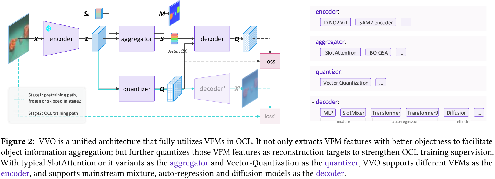
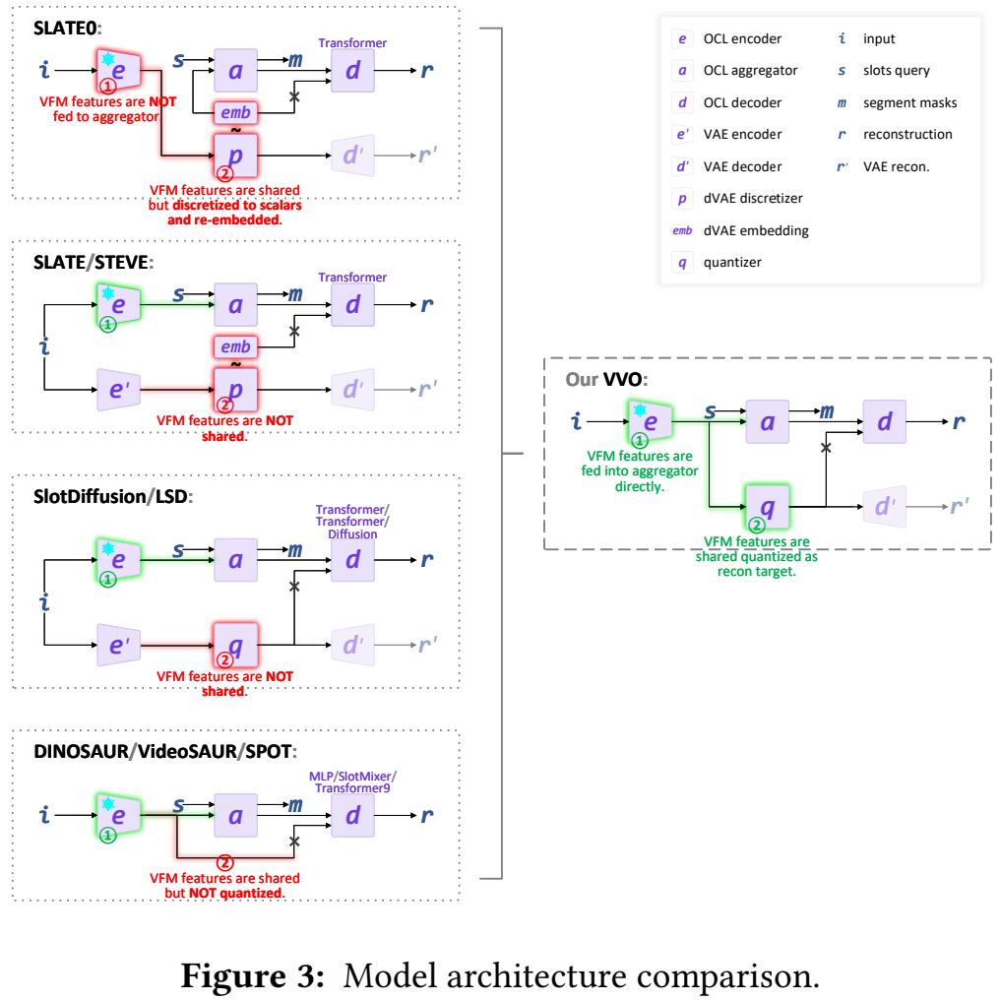
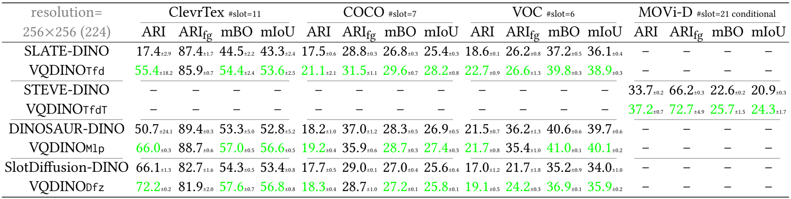
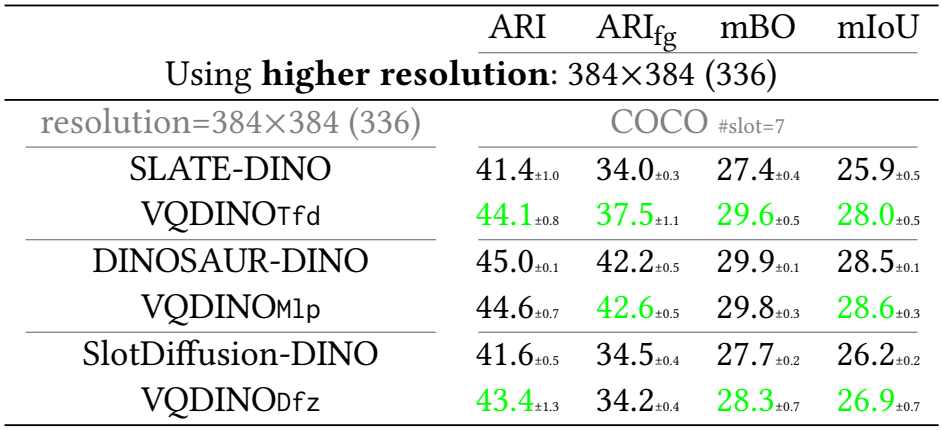
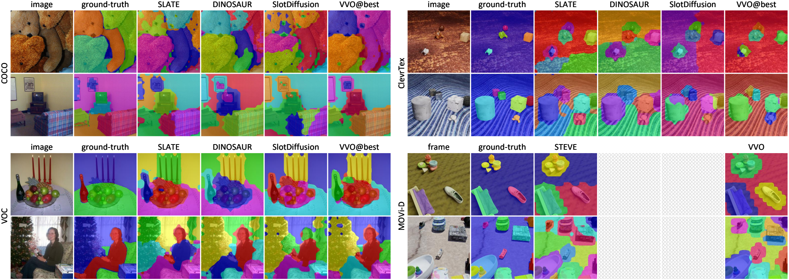
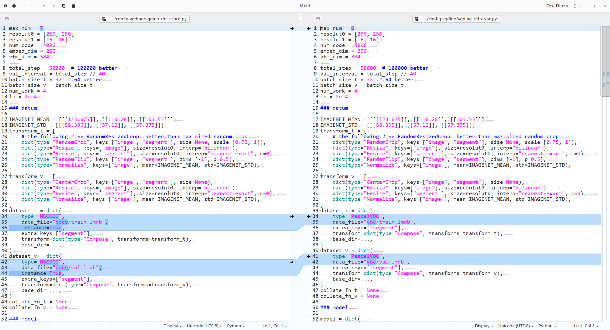

# `VVO` Vector-Quantized Vision Foundation Models for Object-Centric Learning


<br>
<br>

## ⚗️ (2026/01/06) Update !!!

Please check our brand new OCL works:
- **[RandSF.Q](https://github.com/Genera1Z/RandSF.Q)**: significantly surpasses state-of-the-art video OCL, e.g., **SlotContrast**, by **up to 10 points**!
- **[SmoothSA](https://github.com/Genera1Z/SmoothSA)**: improves the state of the art **even further**, e.g., **SPOT** / **DIAS** (images) and **SlotContrast** / **RandSF.Q** (videos), with **minimal modifications**!

<br>
<br>
<br>

---


[](https://arxiv.org/abs/2502.20263)
[](LICENSE)
[](https://docs.pytorch.org/docs/2.15/notes/randomness.html)
[](https://github.com/Genera1Z/VQ-VFM-OCL?tab=readme-ov-file#-model-checkpoints--training-logs)
[](https://github.com/Genera1Z/VQ-VFM-OCL?tab=readme-ov-file#-model-checkpoints--training-logs)


> Object-Centric Learning (OCL) aggregates image or video feature maps into object-level feature vectors, termed \textit{slots}. It's self-supervision of reconstructing the input from slots struggles with complex object textures, thus Vision Foundation Model (VFM) representations are used as the aggregation input and reconstruction target. Existing methods leverage VFM representations in diverse ways yet fail to fully exploit their potential. In response, we propose a unified architecture, Vector-Quantized VFMs for OCL (VQ-VFM-OCL, or VVO). The key to our unification is simply shared quantizing VFM representations in OCL aggregation and decoding. Experiments show that across different VFMs, aggregators and decoders, our VVO consistently outperforms baselines in object discovery and recognition, as well as downstream visual prediction and reasoning. We also mathematically analyze why VFM representations facilitate OCL aggregation and why their shared quantization as reconstruction targets strengthens OCL supervision.


## 🎉 Accepted to ACM MM 2025 as a Poster

Official source code, model checkpoints and training logs for paper "**Vector-Quantized Vision Foundation Models for Object-Centric Learning**".

 

Supported OCL methods include, categorized by OCL decoding:
- Auto-regressive decoding: [SLATE](https://github.com/singhgautam/slate) vs VVO-Tfd, [STEVE](https://github.com/singhgautam/steve) vs VVO-TfdT, [SPOT](https://github.com/gkakogeorgiou/spot) vs VVO-Tfd9
- Mixture-based decoding: [DINOSAUR](https://github.com/martius-lab/videosaur) vs VVO-Mlp, [VideSAUR](https://github.com/martius-lab/videosaur) vs VVO-SmdT
- Diffusion-based decoding: [SlotDiffusion](https://github.com/Wuziyi616/SlotDiffusion) vs VVO-Dfz


## 🏆 Performance


**(1) ⭐⭐⭐ Re-evaluated Performance Values @ Version 3 ⭐⭐⭐**

(Encoding with backbone **DINO2-S/14** at resolution **256x256**/224 and **384x384**/336)

|                                 |    ari    |   arifg  |    mbo   |   miou   |
|---------------------------------|:---------:|:--------:|:--------:|:--------:|
| slate_r_vqvae-clevrtex          |  17.4±2.9 | 87.4±1.7 | 44.5±2.2 | 43.3±2.4 |
| slate_r_vqvae-coco              |  20.5±0.6 | 28.8±0.3 | 27.4±0.3 | 26.1±0.3 |
| slate_r_vqvae-voc               |  22.4±0.2 | 26.3±0.8 | 37.8±0.4 | 36.6±0.3 |
| steve_c_vqvae-movi_d            |  32.7±0.2 | 66.5±0.2 | 23.0±0.3 | 21.2±0.3 |
| vqdino_tfd_r-clevrtex           | 55.4±18.2 | 85.9±0.7 | 54.4±2.4 | 53.6±2.5 |
| vqdino_tfd_r-coco               |  24.4±2.0 | 31.5±1.1 | 30.2±0.6 | 28.8±0.8 |
| vqdino_tfd_r-voc                |  26.9±0.9 | 26.9±1.4 | 40.5±0.3 | 39.5±0.4 |
| vqdino_tfdt_c-movi_d            |  36.7±0.4 | 72.5±3.7 | 26.1±1.2 | 24.6±1.3 |
| dinosaur_r-clevrtex             | 49.6±23.8 | 89.4±0.3 | 52.1±5.4 | 51.7±5.5 |
| dinosaur_r-coco                 |  21.1±1.0 | 37.0±1.2 | 28.7±0.5 | 27.3±0.5 |
| dinosaur_r-voc                  |  25.7±0.6 | 36.3±1.4 | 41.2±0.6 | 40.2±0.6 |
| vqdino_mlp_r-clevrtex           |  64.8±0.3 | 88.8±0.6 | 56.1±0.4 | 55.7±0.5 |
| vqdino_mlp_r-coco               |  22.1±0.4 | 36.0±0.6 | 29.1±0.3 | 27.8±0.3 |
| vqdino_mlp_r-voc                |  25.9±0.9 | 35.6±0.9 | 41.5±0.2 | 40.6±0.2 |
| slotdiffusion_r_vqvae-clevrtex  |  66.1±1.3 | 82.7±1.6 | 54.3±0.5 | 53.4±0.8 |
| slotdiffusion_r_vqvae-coco      |  20.6±0.6 | 29.0±0.1 | 27.5±0.4 | 26.1±0.4 |
| slotdiffusion_r_vqvae-voc       |  20.3±1.4 | 21.6±1.9 | 35.6±1.0 | 34.4±1.1 |
| vqdino_dfz_r-clevrtex           |  72.2±0.2 | 81.9±2.0 | 57.6±0.7 | 56.8±0.8 |
| vqdino_dfz_r-coco               |  21.2±0.3 | 28.7±1.0 | 27.7±0.1 | 26.4±0.1 |
| vqdino_dfz_r-voc                |  22.6±0.5 | 24.4±0.3 | 37.3±0.1 | 36.3±0.2 |
| slate_r_vqvae-coco-r384         |  43.4±1.0 | 34.1±0.3 | 28.1±0.4 | 26.6±0.4 |
| vqdino_tfd_r-coco-r384          |  46.2±0.8 | 37.5±1.1 | 30.3±0.4 | 28.7±0.5 |
| dinosaur_r-coco-r384            |  46.8±0.1 | 42.3±0.6 | 30.4±0.1 | 29.0±0.1 |
| vqdino_mlp_r-coco-r384          |  46.5±0.7 | 42.6±0.5 | 30.3±0.2 | 29.0±0.2 |
| slotdiffusion_r_vqvae-coco-r384 |  43.4±0.5 | 34.5±0.4 | 28.3±0.2 | 26.8±0.2 |
| vqdino_dfz_r-coco-r384          |  45.3±1.2 | 34.3±0.4 | 29.0±0.7 | 27.5±0.7 |


**(2) Old Performance Values**

**Object discovery performance** with DINO2 ViT (s/14) for OCL encoding. VVO is instantiated as VQDINO; Tfd, TfdT, Mlp and Dfz are Transformer, Transformer-temporal, MLP and Diffusion for OCL decoding respectively.



**Using higher resolution**.



**Qualitative  results**.




## 🌟 Highlights

- ✅ **fp16 fast training** [Automatic mixed precision](https://docs.pytorch.org/tutorials/recipes/recipes/amp_recipe.html) training (fp32+fp16) is enabled. Most of the training can be finished less than 4 or 8 hours (for image or video OCL respectively) using one V100 GPU.
- ✅ **less I/O overhead** Datasets are stored in [LMBD](https://lmdb.readthedocs.io) database format to save I/O overhead, beneficial especially on computing cluster.

- ✅ **config-driven experiment** This is totally config-driven framework, largely inspired by [OpenMMLab](https://github.com/open-mmlab), but with much less capsulation.

- ✅ **strong baselines** All models requiring VAE are implemented with StableDiffusion pretrained VAE [TinyVAE](https://huggingface.co/docs/diffusers/v0.30.1/en/api/models/autoencoder_tiny); All models are trained with [strong](https://arxiv.org/abs/2206.07764) data augmentations; All models employ vision foundation model [DINO2](https://huggingface.co/docs/transformers/en/model_doc/dinov2) as their backbone.


## 🚑️ Changelogs

- [2026/01/06] Unify interfaces to [RandSF.Q](https://github.com/Genera1Z/RandSF.Q) and [SmoothSA](https://github.com/Genera1Z/SmoothSA), which are our brand new SotA methods!
- [2025/11/07] Fix ``lmdb`` multiprocessing issues due to ``torch>=3.7``.
- ⭐⭐⭐ [2025/10/20] ⭐⭐⭐ Object discovery accuracy values are updated for version 3.
- [2025/10/19] Version 3: re-implement segmentation evaluation; corresponding new dataset lmdb files are uploaded. Thus, object discovery acc could change a little, especially ARI values.


## 🧭 Repo Stucture

[Source code](https://github.com/Genera1Z/VQ-VFM-OCL).
```shell
- config-slatesteve/    # configs for SLATE and STEVE
- config-dinosaur/      # configs for DINOSAUR
- config-slotdiffusion/ # configs for SlotDiffusion
- config-vqdino/        # *** configs for our VQDINO ***
- object_centric_bench/
  - datum/              # dataset loading and preprocessing
  - model/              # model building
    - ...
    - vaez.py           # *** for vector-quantization ***
    - vqvfmocl.py       # *** for our VVO model building ***
    - ...
  - learn/              # metrics, optimizers and callbacks
- train.py
- eval.py
- requirements.txt
```

[Releases](https://github.com/Genera1Z/VQ-VFM-OCL/releases).
```shell
- dataset-clevrtex/     # dataset files in LMDB format
- dataset-coco/
- dataset-voc/
- dataset-movi_d/
- slatesteve/           # baseline model checkpoints and training logs
- dinosaur/
- slotdiffusion/
- vqdino_tfd/           # our VQDINO-Tfd models and logs
- vqdino_mlp/           # our VQDINO-Mlp models and logs
- vqdino_dfz/           # our VQDINO-Dfz models and logs
- r384/                 # models and logs trained at resolution 384x384
```


## 🚀 Converted Datasets

Datasets ClevrTex, COCO, VOC and MOVi-D, which are converted into LMDB format and can be used off-the-shelf, are available as [releases](https://github.com/Genera1Z/VQ-VFM-OCL/releases).
- [dataset-clevrtex](https://github.com/Genera1Z/VQ-VFM-OCL/releases/tag/dataset-clevrtex): converted dataset [ClevrTex](https://www.robots.ox.ac.uk/~vgg/data/clevrtex).
- [dataset-coco](https://github.com/Genera1Z/VQ-VFM-OCL/releases/tag/dataset-coco): converted dataset [COCO](https://cocodataset.org).
- [dataset-voc](https://github.com/Genera1Z/VQ-VFM-OCL/releases/tag/dataset-voc): converted dataset [VOC](http://host.robots.ox.ac.uk/pascal/VOC).
- [dataset-movi_d](https://github.com/Genera1Z/VQ-VFM-OCL/releases/tag/dataset-movi_d): converted dataset [MOVi-D](https://github.com/google-research/kubric/blob/main/challenges/movi).


## 🧠 Model Checkpoints & Training Logs

**The checkpoints and training logs (@ random seeds 42, 43 and 44) for all models** are available as [releases](https://github.com/Genera1Z/VQ-VFM-OCL/releases). All backbones are unified as DINO2-S/14.
- [slatesteve](https://github.com/Genera1Z/VQ-VFM-OCL/releases/tag/slatesteve): SLATE on ClevrTex, COCO and VOC; STEVE on MOVi-D.
    - My implementation of paper **Illiterate DALL-E Learns to Compose**, ICLR 2022, achieving much better performance.
    - My implementation of paper **Simple Unsupervised Object-Centric Learning for Complex and Naturalistic Videos**, NeurIPS 2022, achieving much better performance.
- [vqdino_tfd](https://github.com/Genera1Z/VQ-VFM-OCL/releases/tag/vqdino_tfd): VQDINO-Tfd on ClevrTex, COCO and VOC; VQDINO-TfdT on MOVi-D.
    - Our VVO's counterparts to SLATE and STEVE.
- [dinosaur](https://github.com/Genera1Z/VQ-VFM-OCL/releases/tag/dinosaur): DINOSAUR on ClevrTex, COCO and VOC.
    - My implementation of paper **Bridging the Gap to Real-World Object-Centric Learning**, ICLR 2023, replacing its DINO2-B/14 with DINO2-S/14.
- [vqdino_mlp](https://github.com/Genera1Z/VQ-VFM-OCL/releases/tag/vqdino_mlp): VQDINO-Mlp on ClevrTex, COCO and VOC.
    - Our VVO's counterpart to DINOSAUR.
- [slotdiffusion](https://github.com/Genera1Z/VQ-VFM-OCL/releases/tag/slotdiffusion): SlotDiffusion on ClevrTex, COCO and VOC.
    - My implementation of paper **SlotDiffusion: Object-Centric Generative Modeling with Diffusion Models**, NeurIPS 2023, replacing its DINO1-B/8 with DINO2-S/14.
- [vqdino_dfz](https://github.com/Genera1Z/VQ-VFM-OCL/releases/tag/vqdino_dfz): VQDINO-Dfz on ClevrTex, COCO and VOC.
    - Our VVO's counterpart to SlotDiffusion.
- [vqdino-r384](https://github.com/Genera1Z/VQ-VFM-OCL/releases/tag/coco-r384): VQDINO-Tfd/Mlp/Dfz on COCO with resolution 384x384 (336x336).
    - Our VVO's counterparts to the baselines training with higher resolution.


## 🔥 How to Use

Take VQDINO-Tfd on COCO as an example.

**(1) Environment**

To set up the environment, run:
```shell
# python 3.11
pip install -r requirements.txt
```

**(2) Dataset**

To prepare the dataset, download ***Converted Datasets*** and unzip to `path/to/your/dataset/`. Or convert them by yourself according to ```XxxDataset.convert_dataset()``` docs.

**(3) Train**

To train the model, run:
```shell
# 1. pretrain the VQDINO VAE model
python train.py \
    --seed 42 \
    --cfg_file config-vqdino/vqdino-coco-c256.py \
    --data_dir path/to/your/dataset \
    --save_dir save

# *. place the best VAE checkpoint at archive-slatesteve/vqvae-coco-c256-msf/best.pth
mv save archive-slatesteve

# 2. train the VQDINO OCL model
python train.py \
    --seed 42 \
    --cfg_file config-vqdino/vqdino_tfd_r-coco.py \
    --data_dir path/to/your/dataset \
    --save_dir save \
    --ckpt_file archive-vqdino/vqdino-coco-c256/best.pth
```

**(4) Evaluate**

To evaluate the model, run:
```shell
python eval.py \
    --cfg_file config-vqdino/vqdino_tfd_r-coco.py \
    --data_dir path/to/your/dataset \
    --ckpt_file archive-vqdino/vqdino_tfd_r-coco/best.pth \
    --is_viz True \
    --is_img True
# object discovery accuracy values will be printed in the terminal
# object discovery visualization will be saved to ./vqdino_tfd_r-coco/
```


## 💡 Tips

1. Any config file can be converted into typical Python code by changing from
```Python
model = dict(type=ClassName, key1=value1,..)
```
to
```Python
model = ClassName(key1=value1,..)
```

2. All config files follow a similar structure, and you can use file comparator [Meld](https://meldmerge.org) with [VSCode](https://code.visualstudio.com/) plugin [Meld Diff](https://marketplace.visualstudio.com/items?itemName=danielroedl.meld-diff) to check their differences.



## 📝 TODO

- ⬜ SPOT & VVO-Tfd9: To be integrated into this framework;
- ⬜ VideoSAUR & VVO-SmdT: To be integrated into this framework.


## 🤗 Contact & Support

If you have any issues on this repo or cool ideas on OCL, please do not hesitate to contact me!
- page: https://genera1z.github.io
- email: rongzhen.zhao@aalto.fi, zhaorongzhenagi@gmail.com

If you are applying OCL (not limited to this repo) to tasks like **visual question answering**, **visual prediction/reasoning**, **world modeling** and **reinforcement learning**, let us collaborate!


## 📚 Citation

If you find this repo useful, please cite our work.
```
@article{zhao2025vvo,
  title={{Vector-Quantized Vision Foundation Models for Object-Centric Learning}},
  author={Zhao, Rongzhen and Wang, Vivienne and Kannala, Juho and Pajarinen, Joni},
  journal={ACM MM},
  year={2025}
}
```
